<p align="center">
  
</p>

<p align="center">
  
  
  
  
  
</p>

<p align="center"><b>An add-on for <a href="https://github.com/radhepa/Village-Friends-Minecraft-Mod">Village Friends</a> (Fabric, Minecraft 26.3).</b><br>
It needs Village Friends to run, and Village Friends never needs it.<br><br>
<i>Plata</i> means silver. The clan's creed is the silverfish: a small grey thing that hides in plain stone,<br>
can't be stamped out, and swarms the moment you disturb it.</p>

<p align="center">
  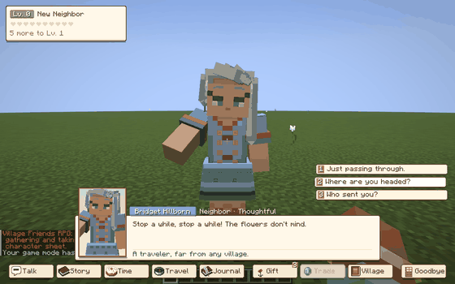
  <br><sub><i>The Molt: a friendly traveler, then a Plata.</i></sub>
</p>

---

## A traveler waits by the road

Out in the Overworld you'll sometimes come across a lone villager in the middle of nowhere: on a desert flat, a
mountain pass, a forest track. To all appearances they're a real Village Friends resident, with a name, a face and a
pleasant word, but they belong to no village. Look closely and you might catch a puff of grey dust at their feet, or
the faint skitter of something small.

**Talk to them.** Village Friends' conversation window opens, and something about what they say is a little off.
Whatever you answer, the disguise drops in **the Molt**:

1. The window closes and they turn to face you, head tilting.
2. They hunch and grip their own shoulders, shivering as grit trickles off them.
3. They curl up tight, the way a silverfish does.
4. A burst of stone dust, and a Plata springs out of it in a backflip, weapons ready.

The first time it happens, the screen reads **THE PLATA CLAN**.

<table>
  <tr>
    <td width="33%">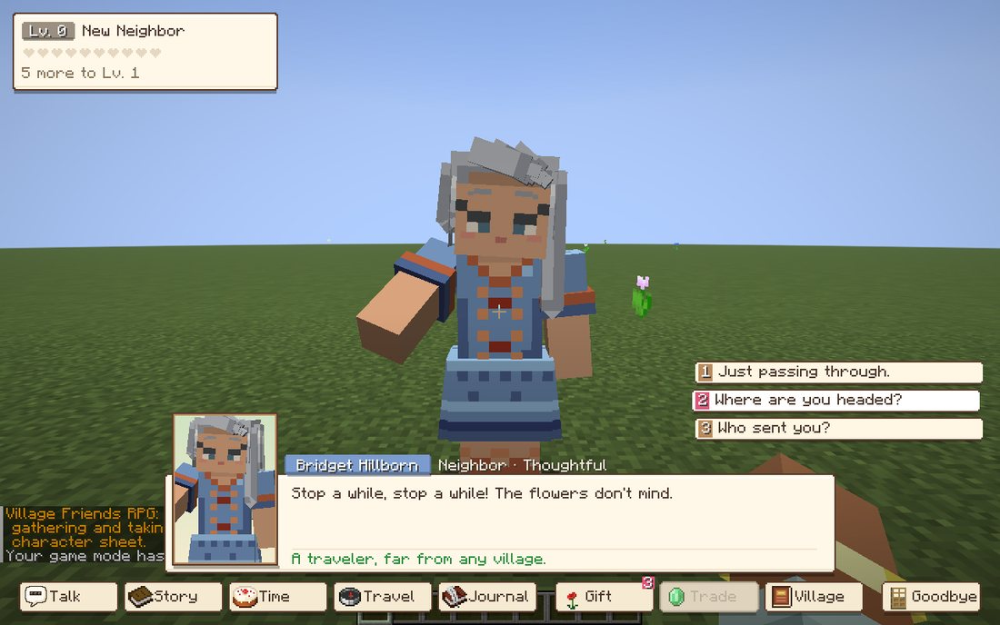<br><sub>A pleasant word from a traveler.</sub></td>
    <td width="33%">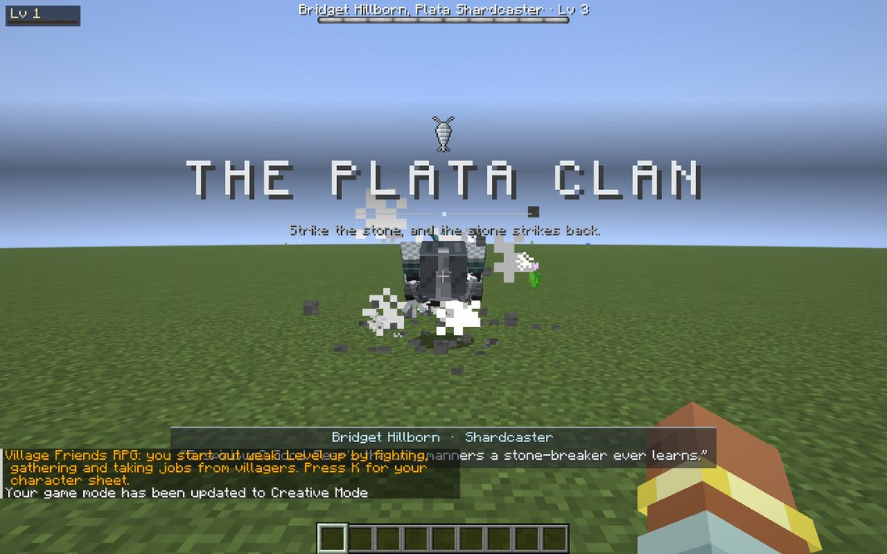<br><sub>The first Molt.</sub></td>
    <td width="33%">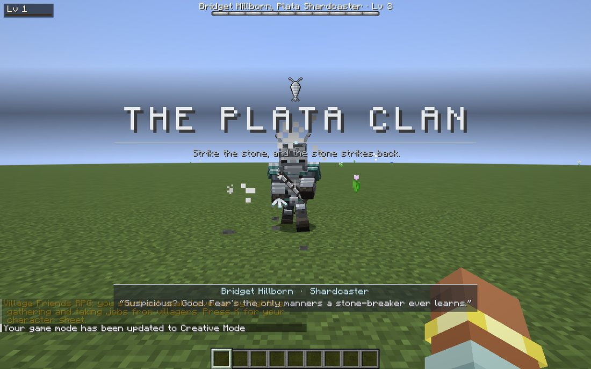<br><sub>Weapons ready.</sub></td>
  </tr>
</table>

## The clan


**They fight like a boss, at your level.** Every Plata has a level from 1 to 100, taken from yours:

- **With [Village Friends RPG](https://github.com/radhepa/Village-Friends-Minecraft-Mod/tree/main/rpg) installed:** your character level.
- **Without it:** a power level read from your armor, weapon, health and experience.

Their health is a fixed number of your own hits. Each of their blows takes a set share of your health after your
armor. So whatever your gear, they're never a pushover and never a one-shot. Higher levels also make them fight
smarter: longer combos, more dodges, shorter cooldowns, quicker reactions.

Every rank can **burrow**: they dive into the ground and come up under you. The only warning is a trail of cracking
grit, then the ground shaking. Hit them as they come up and they stagger. Three quick hits, a critical blow or a
blocked combo staggers them too. Low on health, a Plata **molts**: they burrow twice in a row and fight faster.
Beaten, they curl up and burst into dust, like a silverfish into a wall.

| Drop | Chance |
|---|---|
| Emeralds | always |
| **Silver Scales** | always |
| **Plata Fang**, a quick reverse-grip knife (also craftable) | sometimes |
| **Plata Mask** | rarely |

Wear the Plata Mask and disguised Plata take you for kin. They whisper clan gossip instead of fighting.

The clan keeps count of every silverfish you kill, and the more you've crushed, the more often they come for you.

## Hideouts

The clan lives in the stone, under places nobody looks at twice. Each hideout has a lookout up top: a disguised Plata
who's happy to chat, until they aren't.

<table>
  <tr>
    <td width="50%">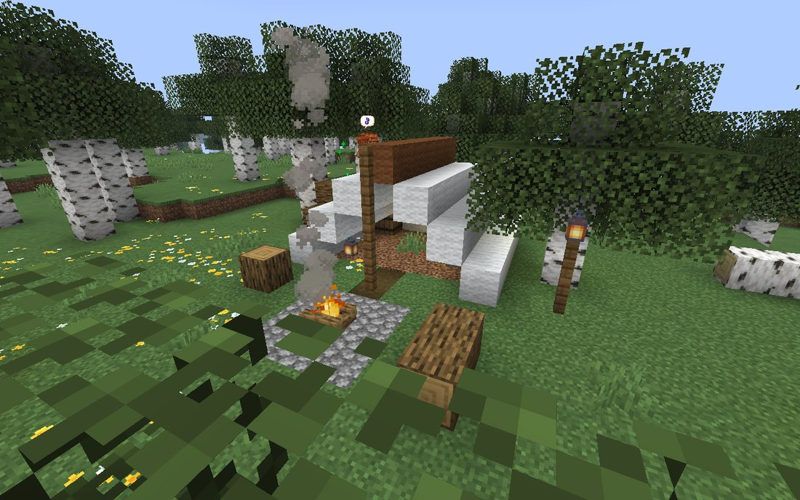<br><sub><b>Scale Den.</b> A traveler's camp. Under the tent, a ladder goes down to a burrow room.</sub></td>
    <td width="50%">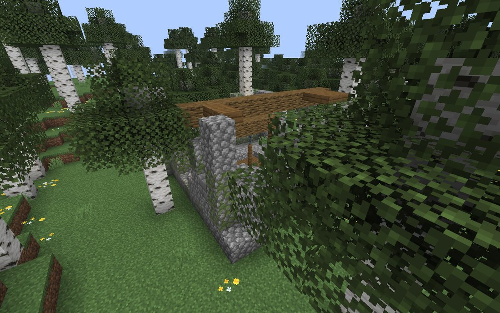<br><sub><b>Silver Warren.</b> A ruined toll-house with an old cistern in the floor.</sub></td>
  </tr>
  <tr>
    <td width="50%">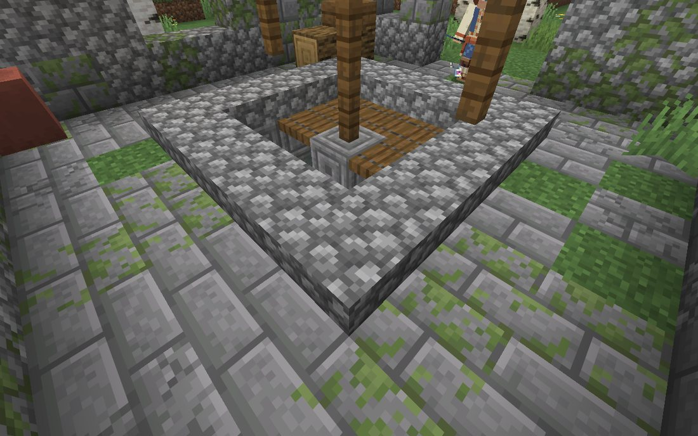<br><sub>The cistern is a spiral stair, twenty blocks down.</sub></td>
    <td width="50%">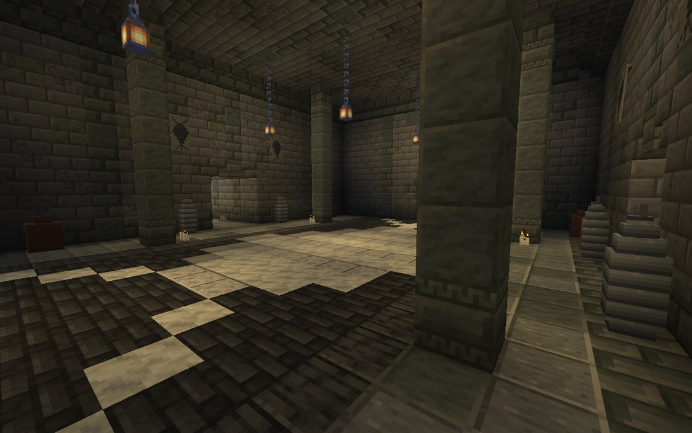<br><sub>The Molting Hall, with the clan's mark set the length of the floor.</sub></td>
  </tr>
</table>

- **Scale Den.** A traveler's camp: a tent, a fire, someone sitting by it. Under the tent a ladder goes down to a single burrow room.
- **Silver Warren.** A ruined toll-house with an old cistern in the floor. The cistern is a spiral stair that drops
  twenty blocks to the **Molting Hall**. Every Warren branches out differently, through ribbed tunnels to some of
  these rooms: the Shell Gallery, a Sparring Pit, the Scale Forge, the Brood (full of silverfish), the Shrine of the
  First Molt and the Storeroom. Behind the hall is the vault: a barred antechamber, then a stair down into the
  Hollow, where the Warren's **Silver Mother** sleeps over the **Clan Coffer**.

Both kinds come in six regional styles: green country, snow and taiga, desert, badlands, savanna and windswept hills.
They keep well away from villages and homesteads.

Down below, the clan **sleeps standing up in silver husks**, their own shed shells:

- **Waking them.** Come within sight and a few blocks of a husk and it cracks open, and a Plata springs out at your level. The husks around it follow. **Sneak** and you can creep much closer.
- **Never a swarm.** No more than three are up at once. The rest wait their turn.
- **Walking away.** Leave and they crawl back into their shells, which seal behind them.
- **Building your own.** In creative, husks can be placed for ambushes of your own.

The walls are stronghold brick, and some of it is infested. Dig through the clan's walls and the walls bite back.

<details>
<summary><b>What's in them</b></summary>

- **Den chests:** food, Silver Scales, shards and emeralds; sometimes a Plata Fang or the **Plata Mark banner
  pattern**; sometimes a **Silver-Inked Map** to the nearest Warren.
- **The forge:** iron and the clan's knives.
- **The Clan Coffer:** the best of it, and always the banner pattern.
</details>

## The Silver Mother


Every Silver Warren has its Mother: the oldest of the clan, who no longer goes out on the road. She took a new name
at her last molt, and the clan calls her by it: **Mother Ysolde**, **Mother Grisel**, **Mother Petra**.

<table>
  <tr>
    <td width="50%">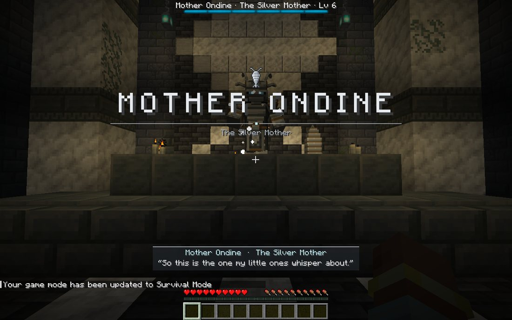<br><sub>She wakes, and her name fills the screen.</sub></td>
    <td width="50%">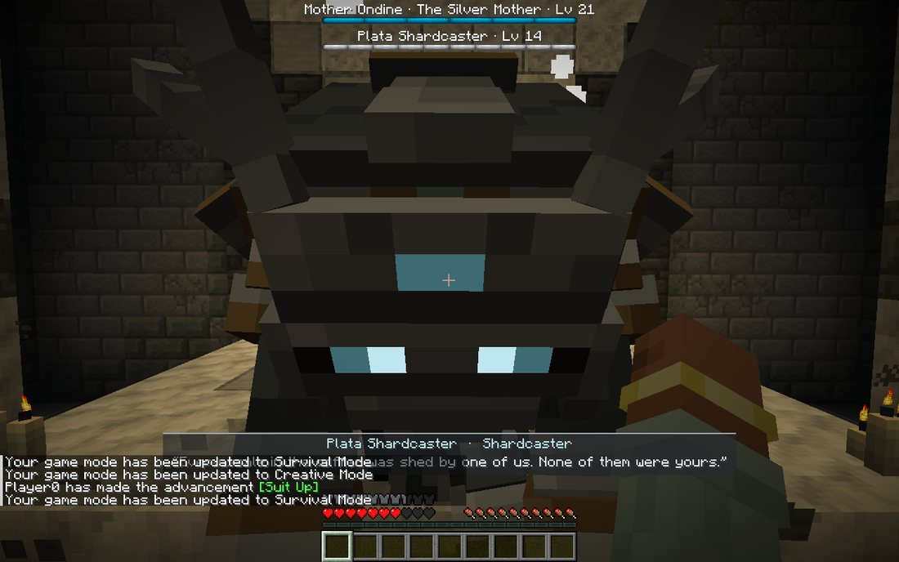<br><sub>Half again as tall as her children, eyes burning cold.</sub></td>
  </tr>
  <tr>
    <td width="50%">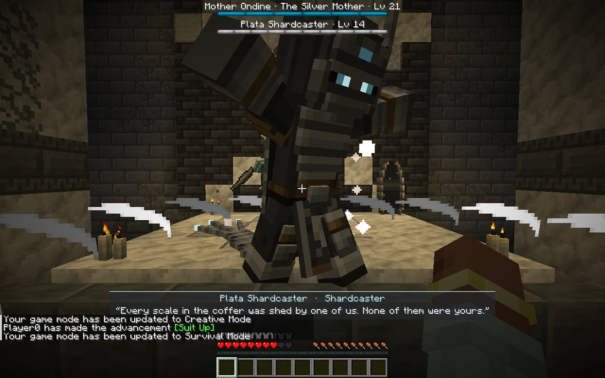<br><sub>The Sweep: her train whips round in a full circle.</sub></td>
    <td width="50%">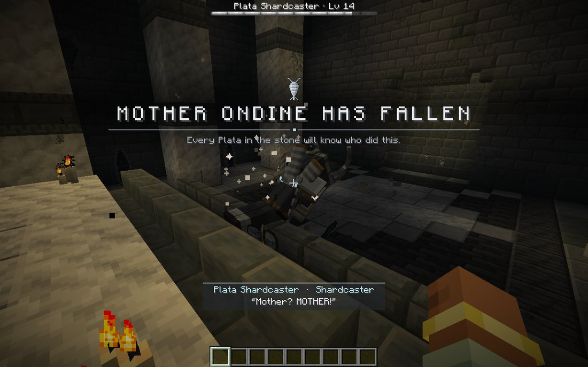<br><sub>When she falls, every Plata in the world knows who did it.</sub></td>
  </tr>
</table>

- **What she looks like.** She wears the clan's own hood and face plate, like any Plata, but she stands half again
  as tall as her children. A circlet of four feelers rides on her hood, a fan collar of shell plates rises behind her
  head, and her train drags along the floor behind her. Her eye slits, her brow and the mark on her train burn with a
  cold light, and silver motes drift round her.
- **Waking her.** She sleeps curled up on her dais at the end of the Hollow. Come within a dozen blocks in her sight,
  or strike her, and she rises. Her name fills the screen, and a boss bar appears.
- **How hard she is.** A Warden-class fight, sized to whoever wakes her: never under 500 health, and about forty to
  sixty of your best hits. Her blows take a third of your health through any armor, and she gets faster as the fight
  goes on.
- **Three phases.** At two thirds of her health she bursts out of her old shell and quickens. At one third she makes
  her last molt: the walls themselves crack and pour out silverfish. Arrows skip off her shell for less damage, and
  enough damage in a short time rocks her back on her heels.
- **If you leave.** If everyone she fights leaves or dies, she walks back to her dais, curls up and sleeps again, whole.
- **When she falls.** Every husk in her Warren splits open, empty, and her children still standing cry out for her,
  then leave the Warren for good. She leaves emeralds, scales, a Plata Mask, an enchanted Plata Fang and diamonds,
  and her **crest** with her name on it.

<details>
<summary><b>Her moves</b></summary>

- the **Crush**: both gauntlets into the floor in front of her. Her hands stick there for a second afterwards, and every hit then lands harder;
- the **Sweep**: her train whips round in a full circle;
- the **Silver Keen**: a shriek in a cone that goes through armor. Put a pillar between you and her;
- the **Brood**: she wakes her children's husks and calls silverfish up out of the floor;
- the **Burrow**: she dives into the floor and comes up under you. The ground shakes in a wide ring first;
- the **Silver Rain** (from her second phase): scales fall round you, and dust falls first where each will land.
</details>

### After a Mother falls

Every Plata out in the wild knows who killed her:

- A disguised traveler lets on that they know ("I won't pretend I don't know you. Mother Ysolde's killer has a
  certain look about them."). Your answers change: proud, sorry, or denying it.
- They still reveal themselves. Then some fight to avenge her: *"You killed Mother Ysolde, prepare to die."* Elders
  and lookouts are likelier to, and so are you if you're proud of it. Hit one first and they always fight.
- The rest **let you be**. They stand there revealed, and you can **right-click them to talk**: ask who the Mother
  was, why they let you be, about the clan, or where it sleeps (they'll point you at the nearest hideout). After a
  couple of minutes, or four answers, they go back into the stone. **Strike one and the truce is over**: they fight back.
- Sleepers in other hideouts wake with her name on their lips. A Plata Mask still fools them, so they whisper to you
  about the Mother's killer, none the wiser.

If you've killed more than one, they name the most recent.

<table>
  <tr>
    <td width="50%">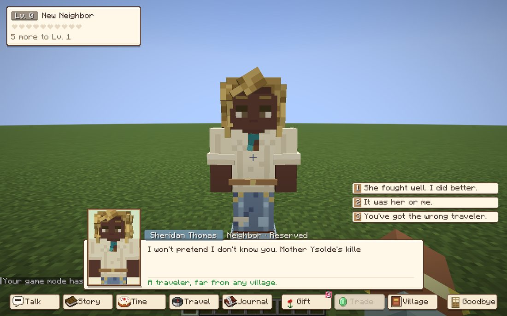<br><sub>"I won't pretend I don't know you."</sub></td>
    <td width="50%">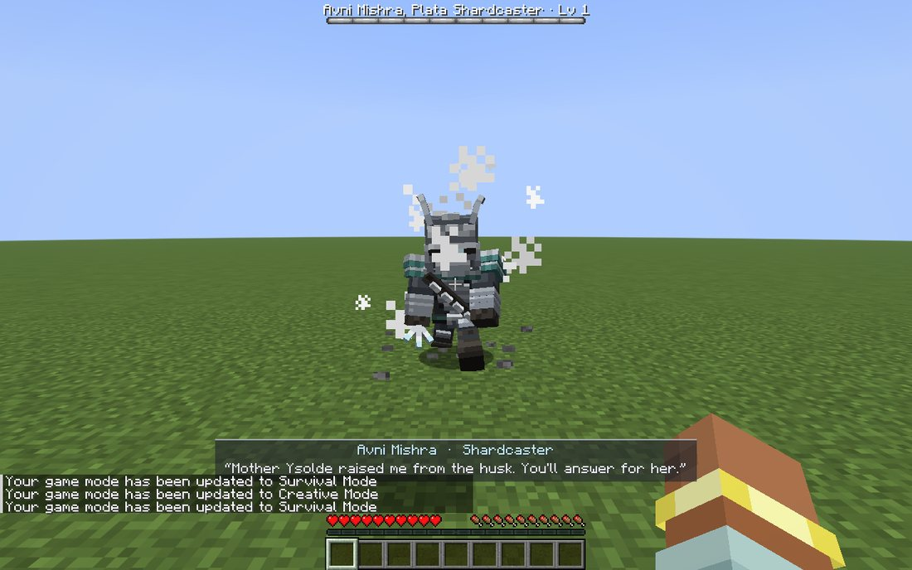<br><sub>Some fight to avenge her.</sub></td>
  </tr>
</table>

---

## Compatibility

- **Village Friends 2.26+** is required. It is hooked from outside only; no Village Friends code is changed. Disguised
  travelers are ordinary residents that belong to no village. Village Friends guards treat a revealed Plata as a threat.
- **Village Friends RPG** is optional. Your RPG level sets theirs, and Plata count toward the **Vermin** family in the Bestiary.
- **[Not-So-Vanilla Mobs](https://github.com/radhepa/Not-so-Vanilla-Mobs)** and
  **[Turning Seasons](https://github.com/radhepa/Seasons)** share no ids and no mixin targets with this mod.
  **[Cave Expansion](https://github.com/radhepa/CaveExpansion)** keeps its delves clear of the clan's hideouts. The
  test suite runs inside the full modpack.

## Settings

`config/plataclan.json`:

| Setting | Default | What it does |
|---|---|---|
| `minutesBetweenEncounters` | 25 | Average minutes between travelers. 0 turns encounters off. |
| `graceMinutes` | 20 | No travelers in a new player's first minutes. |
| `talkFirst` | true | `false`: right-clicking a traveler reveals them at once, with no conversation. |
| `healthScale`, `damageScale` | 1 | Make the clan tougher or gentler. |
| `minDistance`, `maxDistance` | 36, 56 | How far ahead of you a traveler appears. |
| `villageDistance`, `structureChunks` | 160, 6 | How far from any village they keep. |

<details>
<summary><b>Commands</b></summary>

| Command | Who | What it does |
|---|---|---|
| `/plata level` | anyone | How the clan sizes you up. |
| `/plata encounter` | operators | Places a disguised traveler a few blocks ahead. |
| `/plata reveal` | operators | Drops the nearest disguise. |
| `/plata spawn <scuttler\|shardcaster\|warden> [level]` | operators | Spawns a revealed Plata. |
| `/plata mother` | operators | Wakes a Silver Mother a few blocks ahead, sized to you. |
| `/plata mothers` | anyone | The Silver Mothers you've killed. |
| `/locate structure #plataclan:hideouts` | operators | The nearest hideout (`#plataclan:dens`, `#plataclan:warrens` for one kind). |

The three ranks and the Silver Mother also have spawn eggs.
</details>

## Building

Needs JDK 25 and a Village Friends jar to compile against. The build finds it at `-PvillageFriendsJar=<path>`, or as
`libs/village-friends-<version>.jar`, or as the newest `village-friends-*.jar` in the VillageFriends launcher
instance's mods folder.

```
gradlew build                                    # jar in build/libs, runs the unit tests
gradlew runClientGameTest -PtestHeap=2g          # the in-game test, with screenshots in build/run/clientGameTest/screenshots
gradlew runClientGameTest -PcompatMods=<mods>    # the same inside the full modpack (e.g. the instance's mods folder)
```

Use `-PplataTests=Talk,Ranks,Moves,Fight,Mask,Rude,Death,Compat` to run only some scenes.

**Art and data come from the scripts in `tools/`.** Never hand-edit the generated files.

| Tool | What it makes |
|---|---|
| `python tools/plata/build.py` | The costumes (models and textures, three ranks), from `tools/mobkit.py`. Preview with `python tools/preview/preview.py plata_scuttler --views 4`. |
| `python tools/items/items.py --preview` | Items, the worn mask, spawn eggs and the clan mark. |
| `python tools/animations/build_clips.py` | Every animation, in Village Friends' animation-pack format. Contact sheets with `tools/animations/clip_preview.py`. |
| `python tools/lines/build_lines.py --check` | Everything the clan says, from `tools/lines/*.txt`. |

Design notes and numbers are in [DESIGN.md](DESIGN.md).

## License

[MIT](LICENSE). The README art in `docs/readme/` is drawn from the mod's own models and in-game screenshots.
